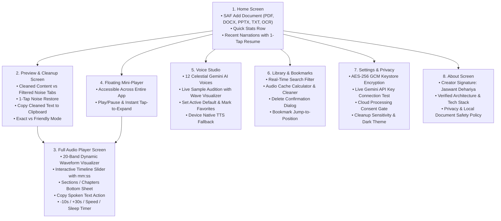

# SpeechWithAbhi — Complete App Pages & Options Catalog

**App Name:** SpeechWithAbhi  
**Creator / Developer Credit:** Jaswant Dehariya  
**Platform:** Native Android (Kotlin + Jetpack Compose + Material 3 + AndroidX Media3)  
**Version:** 1.0.0 Production  
**Date:** November 2026  

---

## Complete Screen & Workflow Architecture

---

### Screen 1: Home Screen (`HomeScreen`)

| UI Element / Section | Functionality & Options |
| :--- | :--- |
| **App Title & Verified Badge** | Displays "SpeechWithAbhi", tagline *"Apni files ko samajhkar, saaf aur natural awaaz mein suno"*, and creator credit **Jaswant Dehariya** with verified badge. |
| **Quick Stats Bar** | Live counter cards: Total Documents count, Audio Cache disk usage in MB, and Active Engines status. |
| **"Add Document" Hero Card** | Modern radiant gradient card launching Android Storage Access Framework (SAF) document picker for PDF, DOCX, PPTX, TXT, Markdown, and Images. |
| **Format Support Badges** | Visual pills with icons showing verified support for PDF, DOCX, PPTX, TXT, and ML Kit On-Device OCR. |
| **Recent Narrations List** | Lists imported documents ordered by recent activity with page counts, file size, and quick Resume button. |
| **View All Button** | Navigates directly to the searchable Library screen. |
| **Persistent Bottom Bar** | 5-tab navigation bar: Home, Library, Voices, Settings, About. |

---

### Screen 2: Preview & Cleanup Review Screen (`PreviewScreen`)

| UI Element / Section | Functionality & Options |
| :--- | :--- |
| **Document Overview Header** | Displays document title, total page count, and breakdown of cleaned sections vs filtered noise items. |
| **Copy All Cleaned Text Action** | Action in top app bar that copies all approved, cleaned text to system clipboard with confirmation feedback. |
| **Tab 1: Cleaned Content** | Ordered list of approved document sections. Displays semantic badge (HEADING, PARAGRAPH, TABLE, LIST_ITEM) and individual checkbox to include/exclude section. |
| **Tab 2: Filtered Noise** | Lists all detected page furniture, repeated headers, footers, and standalone page numbers with explicit reason tags (e.g. `repeated_page_header`). |
| **"Restore to Narration" Action** | One-tap button on any filtered noise item to immediately restore it into the active narration queue. |
| **Narration Style Selector** | Toggle between **Exact** (Faithful Narrator mode: zero hallucinations or filler) and **Friendly** (Friendly Presenter: natural spoken transitions). |
| **"Start Natural Narration" Button** | Compiles semantic narration chunks (max 600 characters, abbreviation-safe), initializes background audio service, and navigates to PlayerScreen. |

---

### Screen 3: Cinematic Audio Player Screen (`PlayerScreen`)

| UI Element / Section | Functionality & Options |
| :--- | :--- |
| **Engine Status Indicator** | Real-time badge showing active voice and engine (`Voice: Kore (Gemini AI)` or `Offline Engine (Device TTS)`). |
| **Sleep Timer Countdown** | Dynamic pill displaying remaining minutes (e.g. `25m left`) when sleep timer is active. |
| **AI Buffering Shimmer** | Pulsating pill showing *"Synthesizing AI audio..."* during lookahead chunk generation. |
| **Waveform Visualizer** | 20 dynamic, gradient-colored dancing equalizer bars animated in real time during audio playback. |
| **Synchronized Spoken Text Card** | Glassmorphic card displaying the exact chunk currently being read aloud, updated in real time as chunks advance. |
| **Copy Spoken Text Action** | Floating copy button on the spoken text card to copy the current sentence/paragraph to the clipboard. |
| **Document Sections Bottom Sheet** | Tap the list icon to open a scrollable sheet of all document sections, with 1-tap jump to any chapter or heading. |
| **Interactive Timeline Slider** | Draggable slider with real-time `mm:ss / mm:ss` timestamps and smooth position seeking. |
| **Playback Speed Selector** | Modal with 0.75x, 1.0x, 1.25x, 1.5x, 1.75x, 2.0x, 2.5x, 3.0x with pitch-preserving Sonic time-stretching. |
| **Voice Profile Quick-Link** | Displays active voice name and opens Voice Studio for instant switching. |
| **Transport Controls** | Large Gradient Play/Pause FAB with glowing elevation, Rewind 10s (`-10s`), Forward 30s (`+30s`), Skip Previous, Skip Next. |
| **Bookmark Action** | Saves current document timestamp and snippet to Room SQLite database with confirmation feedback. |
| **Sleep Timer Modal** | Presets for 15m, 30m, 45m, 60m with "Turn Off Sleep Timer" option. |

---

### Screen 4: Floating Mini-Player (`MiniPlayer`)

| UI Element / Section | Functionality & Options |
| :--- | :--- |
| **Floating Surface Bar** | Floats above bottom navigation on all non-player screens when audio is active. |
| **Track Metadata Display** | Shows current document title, active voice, and speed. |
| **Instant Play/Pause** | One-tap control without leaving current screen. |
| **Tap to Expand** | Tapping anywhere on the bar opens full cinematic `PlayerScreen`. |

---

### Screen 5: Voice Studio Screen (`VoiceStudioScreen`)

| UI Element / Section | Functionality & Options |
| :--- | :--- |
| **Header & Subtitle** | "12 Gemini Celestial AI Voices • Jaswant Dehariya". |
| **12 Celestial AI Voices** | Profiles for **Kore, Puck, Charon, Aoede, Fenrir, Zephyr, Orus, Umbriel, Erinome, Laomedeia, Schedar, Autonoe**. |
| **Acoustic Timbre Descriptions** | Tone profiles (e.g. "Firm, clear, authoritative", "Deep, calm, informative", "Breezy, natural, relaxed"). |
| **Live Sample Audition** | Tap "Audition" to play sample Hindi/English audio. Shows an animated mini soundwave and a "Stop" button while playing. |
| **Active Default Selector** | Saves preferred default voice across all narrations to DataStore preferences. |
| **Favorite Voice Star/Heart** | Toggles voice in user favorites set. |
| **Offline Device TTS Notice** | Transparent routing to on-device TextToSpeech when offline or without API key. |

---

### Screen 6: Library & Bookmarks Screen (`LibraryScreen`)

| UI Element / Section | Functionality & Options |
| :--- | :--- |
| **Instant Search Bar** | Live text search filtering documents by title. |
| **Audio Cache Manager Card** | Displays synthesized audio cache disk space in MB with "Clear Cache" button. |
| **Clear Cache Confirmation** | Safeguard dialog preventing accidental cache deletion. |
| **Tab 1: Documents** | All imported documents with page count and file size in KB. |
| **Delete Document Action** | Deletes document record and cached audio with confirmation dialog. Leaves user original files completely safe. |
| **Tab 2: Bookmarks** | All saved timestamps with document title, snippet text, and 1-tap jump to saved position. |

---

### Screen 7: Settings & Privacy Screen (`SettingsScreen`)

| UI Element / Section | Functionality & Options |
| :--- | :--- |
| **Offline Capable Banner** | Assures users that SpeechWithAbhi works 100% offline with device TTS if no API key is set. |
| **Gemini API Key Card** | Masked password text field with visibility toggle, "Save Key" (stored in Android Keystore AES-256 GCM), and "Clear Key". |
| **"Test Key" Action** | Live verification button that pings Google Gemini API model metadata to check key validity instantly before narration. |
| **Cloud Consent Gate** | Explicit user toggle required before any text chunks are dispatched to cloud APIs. |
| **Cleanup Sensitivity** | Selectable thresholds: **Conservative**, **Balanced**, and **Aggressive**. |
| **Dark Theme Switch** | Toggles between Deep Midnight Navy (#0A0F1D) and Light theme. |

---

### Screen 8: About & Credits Screen (`AboutScreen`)

| UI Element / Section | Functionality & Options |
| :--- | :--- |
| **App Branding & Logo** | SpeechWithAbhi (v1.0.0 Production Release). |
| **Creator Credit Badge** | **Jaswant Dehariya** (Principal Android Architect & AI Engineer). |
| **Verified Architecture** | Kotlin 2.0+, Jetpack Compose M3, AndroidX Media3 (ExoPlayer + MediaSessionService), Gemini Generative Audio, Room DB, ML Kit OCR. |
| **Privacy & Safety Policy** | Guarantee that user files are never modified, deleted, or uploaded without explicit permission. |

---

*Compiled and verified for SpeechWithAbhi by Jaswant Dehariya.*
