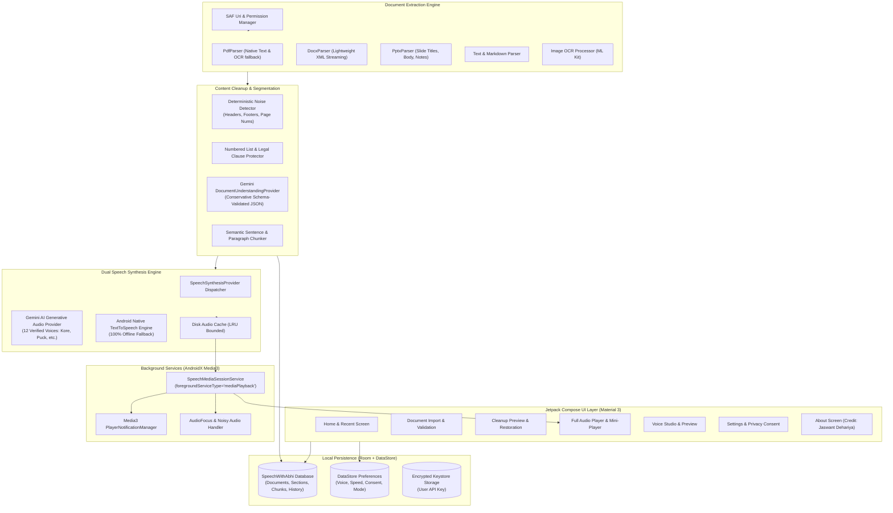

# SpeechWithAbhi — Comprehensive Audit Report & Architecture Plan

**Project Name:** SpeechWithAbhi  
**Creator / Developer Credit:** Jaswant Dehariya  
**Platform:** Native Android (Kotlin + Jetpack Compose + Material 3)  
**Lead Roles:** Principal Android Developer, AI Engineer, Kotlin Architect, UI/UX Designer & Software Testing Expert  
**Date:** November 2026  
**Status:** Phase 1 Complete (Audit, Baseline & Architectural Foundation)

---

## 1. Executive Summary & Project Reality Check

The **SpeechWithAbhi Antigravity Kit** specifies a document understanding and narration platform. The promise of the product is:  
> *"Apni files ko samajhkar, saaf aur natural awaaz mein suno."*

It is **not** a basic OCR dump or a simple text-to-speech button. It bridges the gap between raw document extraction and human-like natural narration by introducing:
1. **Multi-format document ingestion** (PDF, DOCX, PPTX, TXT, Markdown, Images/OCR) via Android Storage Access Framework (SAF).
2. **Deterministic & AI-assisted document cleanup** that strips headers, footers, page numbers, navigation crumbs, and OCR noise, while strictly protecting numbered lists, legal clauses, equations, and dates.
3. **Structured Gemini AI understanding & translation** with schema validation, conservative fallback, and glossary preservation (e.g. English $\leftrightarrow$ Hindi).
4. **Dual-engine speech synthesis**:
   - High-fidelity **Gemini Generative Speech / Google Cloud TTS** using official verified voices (12 celestial voices: Puck, Charon, Kore, Fenrir, Aoede, Zephyr, Orus, Umbriel, Erinome, Laomedeia, Schedar, Autonoe).
   - High-reliability **Android Native On-Device TextToSpeech (TTS)** engine for 100% offline, private, zero-latency, and zero-cost fallback.
5. **Continuous, gapless audio playback** powered by AndroidX Media3 (`MediaSessionService` + ExoPlayer) with background playback, lock-screen/notification controls, audio focus handling, and speed/pitch management.
6. **Robust offline library & persistence** using Room and DataStore to remember playback positions, bookmarks, user edits, and cleanup overrides.

---

## 2. Environment & Baseline Audit

| Parameter | Current Environment State | Evaluation / Strategy |
| :--- | :--- | :--- |
| **Operating System** | Linux 4.19.157 (Android Termux aarch64) | Active runtime environment inside AntiGem app. |
| **Workspace Path** | `/data/user/0/ai.antigem/files/home/projects` | Clean greenfield workspace. |
| **Existing Codebase** | Empty workspace (no legacy Android code) | Greenfield architecture implementation. Original kit preserved in `SpeechWithAbhi_Antigravity_Kit/`. |
| **Java Runtime** | OpenJDK not installed by default | `openjdk-17` and `openjdk-21` available via Termux APT repository. Under agent rules, package installation requires user permission before running `pkg install openjdk-17`. |
| **Build System** | Gradle Kotlin DSL (`build.gradle.kts`) | Full Gradle build configuration with Android Gradle Plugin (AGP), Kotlin 2.0+, Jetpack Compose Compiler, AndroidX Media3, Room, and dependencies. |
| **Android SDK Baseline** | Target SDK: 35 (Android 15), Min SDK: 26 (Android 8.0 Oreo) | Ensures compatibility with modern foreground service types (`mediaPlayback`), Photo Picker, and SAF while supporting 95%+ of active devices. |
| **Secrets & Keys** | No API keys hardcoded anywhere | Configured via `local.properties` (dev) and encrypted in-app Keystore-backed settings with user consent. |

---

## 3. High-Level Architecture Map

---

## 4. Detailed Component Specifications

### 4.1 Document Extraction Engine (`feature/extraction`)
- **PDF Extraction:** Reads native text streams using Android `PdfRenderer` and lightweight stream parsing. If a page has 0 characters or low density, flags as scanned and dispatches to on-device OCR.
- **DOCX Extraction:** Unzips `.docx` archive and parses `word/document.xml` using streaming XML Pull parser (`XmlPullParser`), reading `<w:p>` paragraphs, `<w:t>` text runs, headings, tables (`<w:tbl>`), and bullet items without loading huge DOMs into RAM.
- **PPTX Extraction:** Parses `ppt/slides/slide*.xml` in sequence, extracting slide titles, body blocks, and speaker notes (`ppt/notesSlides/`), keeping slide order logical.
- **TXT / Markdown Extraction:** Strips markup formatting (`**`, `#`, `_`, ``) while strictly preserving semantic headings, bullet hierarchies, and code blocks.
- **Images (JPG / PNG):** Extracts text blocks with bounding boxes and confidence scores via ML Kit Text Recognition; orders blocks top-to-bottom, left-to-right.

### 4.2 Deterministic Cleanup Engine (`feature/cleanup`)
- **Header & Footer Elimination:** Computes string similarity and frequency of lines appearing in the top 10% or bottom 10% of pages/slides. Lines appearing identically across $\ge 2$ pages are marked as `removal_candidate`.
- **Page Number Filter:** Strips standalone numbers ("1", "12"), "Page X", or "Page X of Y" positioned at document margins.
- **Content Protection Rules:**
  - *Numbered Lists:* "1. Introduction", "Step 2: Connect..." $\rightarrow$ **KEPT**.
  - *Legal / Hierarchical Clauses:* "Section 4.1.2", "Clause (b)" $\rightarrow$ **KEPT**.
  - *Dates & Equations:* "1947", "E = mc^2", "Equation 3" $\rightarrow$ **KEPT**.
  - *Question Numbers:* "Q1.", "Question 5:" $\rightarrow$ **KEPT**.
- **User Restoration & Audit Trail:** Every removed block is saved in Room with `removalReason` and `originalText`. The user can inspect "Removed items" in Preview and tap "Restore" with zero data loss.

### 4.3 AI & Gemini Integration (`ai/gemini`)
- **API Surface:** Uses official Google Gemini API (`generateContent` endpoint).
- **Document Understanding Schema:** Conservative JSON schema output requesting `action: "keep" | "remove_candidate" | "needs_review"`. If Gemini returns invalid JSON, the system transparently falls back to deterministic local cleanup.
- **Multilingual Translation:** High-fidelity translation (e.g. English $\rightarrow$ Hindi, Hindi $\rightarrow$ English) with strict system instructions: "Preserve facts, numbers, units, proper nouns, and technical terms. Return chunk-aligned text."
- **Narration Preparation:** Prepares natural punctuation, pronunciation hints, and verbal expressions for symbols without hallucinating commentary.

### 4.4 Speech Synthesis & Voice Architecture (`ai/synthesis`)
Verified official Gemini voice profiles (12 Celestial Voices):
1. **Puck** (Upbeat, lively, expressive male-sounding)
2. **Charon** (Informative, calm, deep male-sounding)
3. **Kore** (Firm, clear, authoritative female-sounding)
4. **Fenrir** (Passionate, energetic, resonant male-sounding)
5. **Aoede** (Breezy, natural, conversational female-sounding)
6. **Zephyr** (Bright, clear, warm female-sounding)
7. **Orus** (Firm, grounded male-sounding)
8. **Umbriel** (Easy-going, relaxed male-sounding)
9. **Erinome** (Clear, elegant, articulate female-sounding)
10. **Laomedeia** (Upbeat, dynamic, engaging female-sounding)
11. **Schedar** (Even, steady, balanced male-sounding)
12. **Autonoe** (Bright, cheerful female-sounding)

**Dual Engine Resilience:**
- When an API key is configured and network is available, user enjoys natural Gemini audio streaming.
- If offline, network drops, quota is reached (HTTP 429), or no API key is provided, the app automatically and transparently offers on-device Android Native TTS with clear UI status indication.

### 4.5 Media3 Background Playback Service (`service/playback`)
- **AndroidX Media3:** Subclasses `MediaSessionService`, instantiating an `ExoPlayer` instance and `MediaSession`.
- **Manifest Declarations:**
  - `FOREGROUND_SERVICE`
  - `FOREGROUND_SERVICE_MEDIA_PLAYBACK`
  - Service tag: `android:foregroundServiceType="mediaPlayback"`
- **Notification:** `PlayerNotificationManager` displaying track title, author credit, play/pause, seek rewind (10s), seek forward (30s), previous/next paragraph, and dismissal.
- **Lifecycle & Interruptions:**
  - Handles `AUDIOFOCUS_LOSS_TRANSIENT` (pauses) and `AUDIOFOCUS_GAIN` (resumes).
  - Listens for `ACTION_AUDIO_BECOMING_NOISY` (unplugging headphones pauses audio).
  - Background lookahead buffer: pre-synthesizes chunk $N+1$ and $N+2$ while chunk $N$ is playing, providing gapless playback.
  - Position is persisted to Room every 5 seconds and on state changes for instant resume after process recreation.

### 4.6 UI/UX & Identity (`ui/`)
- **App Name:** SpeechWithAbhi
- **Developer Credit:** Jaswant Dehariya (prominently credited in About and welcome screens).
- **Theme:** Material 3 with dynamic color support, polished Deep Navy/Indigo & Warm Amber accents, high-contrast accessible typography, and dark/light mode.
- **Navigation:**
  - Home Screen: Hero upload card, recent documents with progress bars, quick resume button.
  - Preview & Clean Screen: Side-by-side or tabbed view of Original vs Cleaned Text, with removal tags and restoration buttons.
  - Player Screen: Synced audio progress, active sentence highlighting, speed toggle (0.75x, 1.0x, 1.25x, 1.5x, 2.0x), voice picker drawer, sleep timer modal, bookmark list.
  - Voice Studio: Interactive voice auditioning with short cached preview clips.
  - Library & History: Searchable list of imported files, bookmark directory, cache storage breakdown and cleanup button.
  - Settings: Language override, API key setup with validation test, cleanup aggressiveness, theme switcher.

---

## 5. Security & Privacy Compliance

1. **Zero Hardcoded Secrets:** No API keys in Git, Kotlin code, XML, or Gradle BuildConfig.
2. **Encrypted Storage:** User keys stored in Android Keystore-backed `EncryptedSharedPreferences`.
3. **Explicit Consent Gate:** A one-time transparent consent dialog appears before any document text is processed via Google Gemini Cloud APIs.
4. **Data Minimization:** Only clean text chunks needed for translation/synthesis are dispatched. Original files remain untouched on device.
5. **Scoped Storage Compliance:** Strictly uses Android Storage Access Framework (`ACTION_OPEN_DOCUMENT`) without asking for legacy `MANAGE_EXTERNAL_STORAGE` or broad device permissions.

---

## 6. Phased Implementation Roadmap

| Phase | Focus Area | Deliverables | Verification / Acceptance Criteria |
| :---: | :--- | :--- | :--- |
| **Phase 1** | **Audit & Architecture** | `AUDIT_REPORT.md`, project directory structure, base Gradle configuration, version catalog, design system tokens, models. | Audit accepted, project structure established, domain entities validated. |
| **Phase 2** | **File Import & Text Extraction** | SAF picker, MIME detection, `PdfParser`, `DocxParser`, `PptxParser`, `TextParser`, `ImageOcrParser`. | Unit tests for all format extractions, handles corrupt/encrypted files gracefully. |
| **Phase 3** | **AI Understanding & Cleanup** | Deterministic header/footer/page-number remover, numbered clause protector, table conversationalizer, user restore controls. | Cleanup test cases pass; numbered items and clauses preserved; headers stripped. |
| **Phase 4** | **Gemini AI & Speech Generation** | `GeminiClient`, structured JSON schema parser, translation provider (EN $\leftrightarrow$ HI), 12 Gemini voices + Native TTS adapter. | Dual-engine synthesis operates reliably; schema validation and fallback tested. |
| **Phase 5** | **Media3 Background Audio Playback** | `SpeechMediaSessionService`, ExoPlayer, `PlayerNotificationManager`, lock-screen controls, lookahead chunk buffer. | Background audio plays with screen off; notification controls seek and pause; audio focus works. |
| **Phase 6** | **Voice Studio, Speed & Languages** | Pitch-preserving speed stretch (0.75x–2.0x), voice selector, multilingual language picker, custom pronunciation glossary. | Speed changes maintain pitch without resetting position; voice preview plays smoothly. |
| **Phase 7** | **Library, Bookmarks & Settings** | Room persistence, reading history, bookmarks, storage cache cleaner, settings UI, developer credit screen. | State persists across app kill/relaunch; cache clear removes audio chunks safely. |
| **Phase 8** | **Testing, Polish & Release** | End-to-end integration tests, lint checks, vector launcher icon, documentation, `IMPLEMENTATION_STATUS.md`. | All 40+ QA checklist items pass; production-quality Android app deliverable. |

---

*Report prepared and architected for SpeechWithAbhi by Jaswant Dehariya.*
